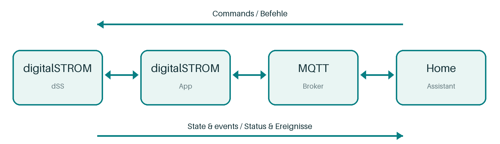
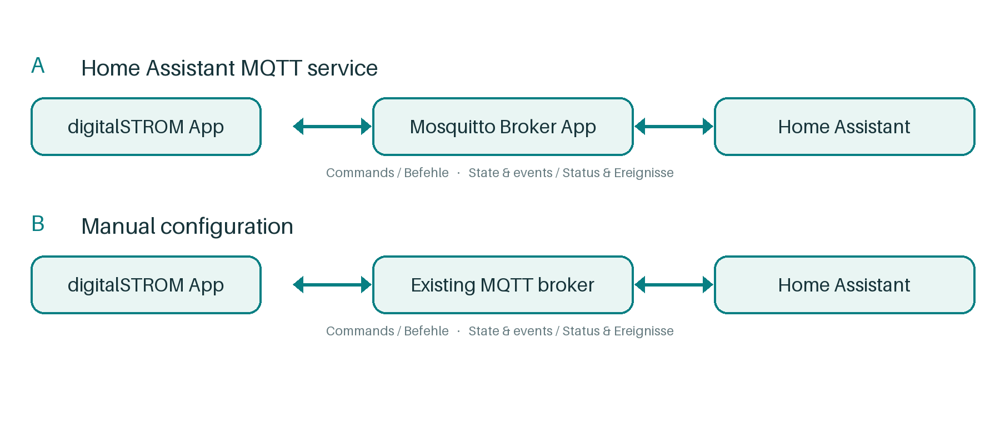
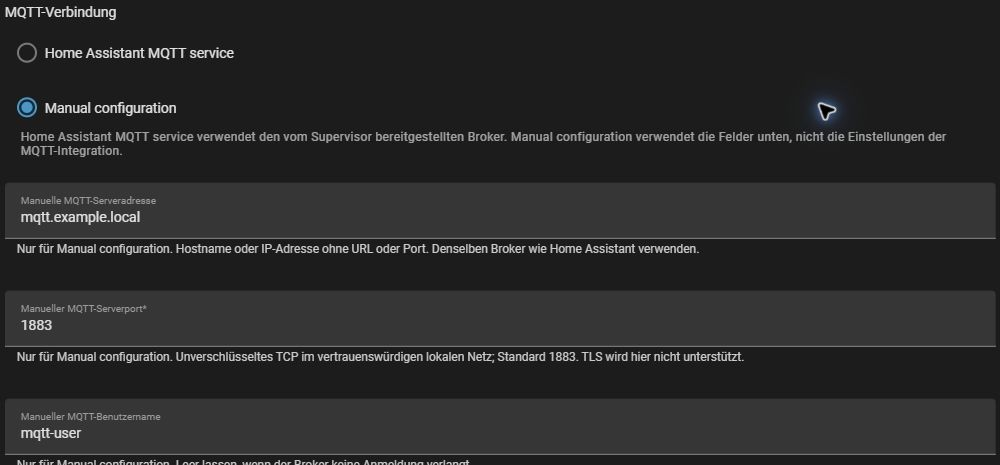
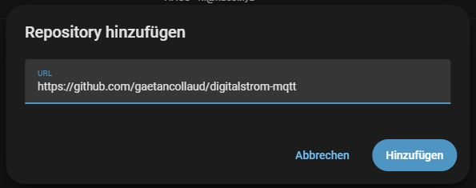
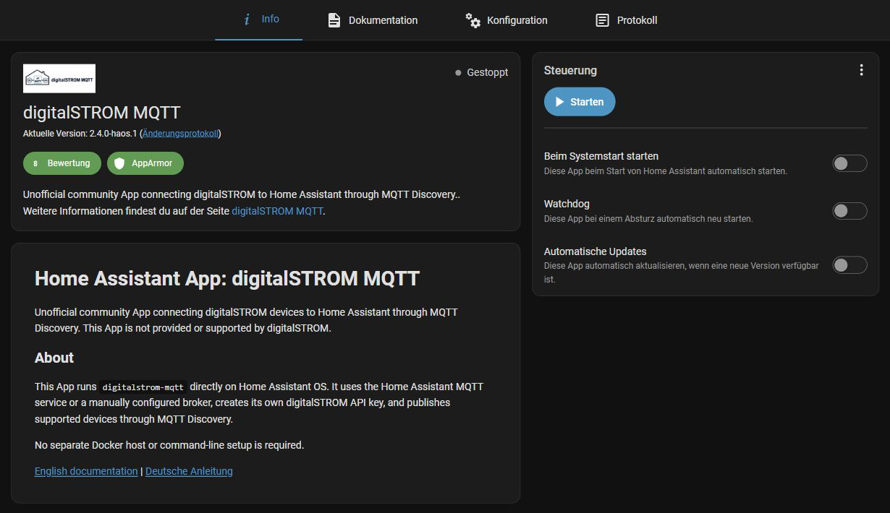
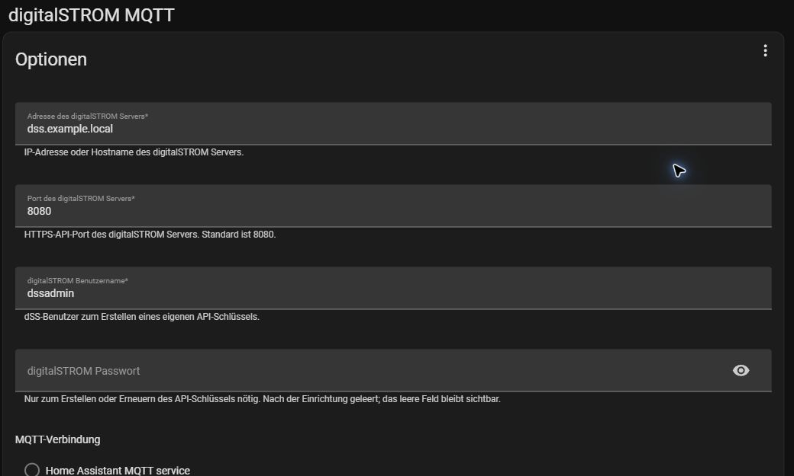

# digitalSTROM MQTT

## 1. Before you begin

A beginner's guide to connecting digitalSTROM to Home Assistant

**Current release: 2.4.0-haos.1.** The regular Home Assistant App is available from the project's App repository. This is an unofficial community project and is not provided or supported by digitalSTROM.

The screenshots show a German-language Home Assistant interface. Follow the English menu and field names in the steps.

### Have these things ready

- **Home Assistant OS** with **Settings > Apps**. The App does not run on Home Assistant Container.
- A working **digitalSTROM Server (dSS)** that Home Assistant can reach on your home network.
- The dSS address, username and password. These are for the digitalSTROM Server, not your Home Assistant login or a digitalSTROM cloud account. The usual username is **dssadmin**.
- An MQTT broker. If you are new to MQTT, section 2 explains the simplest option.

### How the parts fit together

The App and Home Assistant's **MQTT integration** use the same broker. The App announces devices through MQTT Discovery and publishes their state. Home Assistant sends commands through the broker to the App and dSS.

### Already using digitalstrom-mqtt?

Stop the existing bridge before starting this App. Keep the old installation available until the new App has passed its checks and restart. If your old setup uses custom MQTT topic names or discovery settings, review the migration notes in the detailed documentation first.

### Find your next step

- **Sections 2 and 3:** Set up MQTT and install the App.
- **Section 4:** Check connections and devices.
- **Sections 5 and 6:** Updates, recovery and help.

<!-- pagebreak -->

## 2. Choose your MQTT setup

If you do not have an MQTT broker yet, choose **A**. This is the simplest start: the broker runs in Home Assistant, and the App receives its connection details automatically. **B** is for an existing broker elsewhere. Use only one connection mode in the digitalSTROM App.

### A. Home Assistant MQTT service

1. Open **Settings > Apps > App store**. Find **Mosquitto broker**, install it and start it.
2. Open **Settings > Devices & services**. If MQTT is discovered, select **Configure**. Otherwise select **Add integration > MQTT** and follow the setup prompts.
3. Confirm that the MQTT integration is connected to the Mosquitto broker.

In the digitalSTROM App, keep **MQTT connection** set to **Home Assistant MQTT service**. This is the default. Home Assistant supplies the App with the broker connection details. Leave the manual MQTT fields alone; the App ignores them in this mode. You do not need to copy the Mosquitto password.

### B. Manual configuration for an existing broker

1. In **Settings > Devices & services**, open the **MQTT** integration. If it is missing, select **Add integration > MQTT**.
2. Connect Home Assistant to your existing broker. Ask its administrator for the address, port and login if you need them.
3. In the digitalSTROM App, select **Manual configuration** and enter the same broker address, port and an allowed login.

The App does not copy settings from Home Assistant's MQTT integration. If Home Assistant uses an external broker, enter that broker separately in the App. Manual configuration does not require Mosquitto in Home Assistant and does not fall back to the Home Assistant MQTT service.

### Manual connection limits

Manual settings use plain, unencrypted MQTT on a trusted local network, normally port **1883**. TLS and custom certificates are not supported by these App options. Do not disable encryption on a public broker to make this mode work; ask for help with a compatible local setup.

**Ready to continue:** Home Assistant's MQTT integration is connected to the same broker that the digitalSTROM App will use.

## 3. Install and configure the App

### Add the project's App repository

1. Open **Settings > Apps > App store**.
2. Open the **three-dot menu > Repositories**, select **Add**, and enter:

https://github.com/gaetancollaud/digitalstrom-mqtt

3. After adding the repository, return to the App store and find **digitalSTROM MQTT**.
4. Select **Install** and wait for it to finish. The current regular release is **2.4.0-haos.1**.

You can also use Home Assistant's [Add repository button](https://my.home-assistant.io/redirect/supervisor_add_addon_repository/?repository_url=https%3A%2F%2Fgithub.com%2Fgaetancollaud%2Fdigitalstrom-mqtt).

### Enter your dSS details

Open the App's **Configuration** tab:

- **digitalSTROM Server address:** IP address or hostname, without `https://`, a path or a port.
- **digitalSTROM Server port:** Keep **8080** unless your dSS uses a different HTTPS API port.
- **digitalSTROM username:** Your dSS account; the usual default is **dssadmin**.
- **digitalSTROM password:** Enter the dSS password for this first setup.
- **MQTT connection:** Choose **Home Assistant MQTT service** for route A in section 2, or **Manual configuration** for route B.

### Only for manual configuration

- **Manual MQTT server address:** Broker hostname or IP, without a protocol prefix or port. Enter IPv6 addresses without brackets.
- **Manual MQTT server port:** Usually **1883**.
- **Manual MQTT username** and **Manual MQTT password:** Use the broker login. Leave them empty only if the broker allows connections without a login. This password is separate from the dSS password and remains saved for reconnects.

Leave other options at their defaults for now. Keep **Regenerate API key** off on the first start. Select **Save**, open the **Info** tab and select **Start**.

## 4. Check that it is working

### Check the App log

<!-- figure-slot: App connection log | Alt text: App log showing the successful MQTT and digitalSTROM WebSocket messages without private broker names. -->

Open the **Log** tab and allow startup to finish. Look for these messages:

- **Connected to MQTT server.**
- **Connected to websocket for notifications**
- On the first setup or after regenerating the key: **The digitalSTROM API key setup is complete; the temporary password option is clear.**

The first two messages confirm separate connections. MQTT carries device data to Home Assistant; the dSS WebSocket carries live changes from digitalSTROM. A running App status by itself does not confirm either connection. Temporary connection errors may retry, so allow a little time for startup.

### The empty dSS password field is expected

After successful setup, the App creates and saves its own dSS API key, then clears the temporary password value. The **digitalSTROM password** field remains visible but empty. Leave it empty on later starts. You do not need to copy or paste the API key.

### Check for devices

<!-- figure-slot: Discovered devices | Alt text: Home Assistant MQTT integration listing discovered digitalSTROM devices and entities, with personal names removed. -->

1. Open **Settings > Devices & services > MQTT** and look for supported digitalSTROM devices and their controls or readings. Home Assistant calls an individual control or reading an **entity**.
2. Check that readings are available. Not every digitalSTROM device or function is supported.
3. On the App's **Info** tab, select **Restart**. Confirm that the connection messages return and devices become available again without re-entering the dSS password.

Discovery confirms that devices were announced; it does not prove that every function works. If you want to try a control, use a familiar light and check its actual response. Do not operate blinds or other equipment just to complete setup.

**Setup is complete when** the log confirms both connections, supported devices appear under MQTT, and a normal restart succeeds.

## 5. Recovery, updates and removal

### Start the App automatically

On the App's **Info** tab, enable **Start on boot** if you want the App to start with Home Assistant. This is separate from its watchdog and update settings.

### Watchdog and connection recovery

After the first complete startup, the App enables Home Assistant's **Watchdog** automatically. Home Assistant can use it to restart the App if its health check detects work that is stuck. Startup pauses the watchdog while the App validates settings and creates the dSS API key. Invalid credentials still need your attention. A broker outage by itself does not trigger the health check, and the watchdog cannot detect every device or protocol problem.

If you later turn the watchdog off, the App preserves that choice across restarts and updates. The App retries temporary connection failures, including an MQTT service that is not ready yet.

### Updates

After the first complete startup, the regular App enables Home Assistant's **Auto update** once. If you prefer to review releases first, turn **Auto update** off on the App's page after setup. Home Assistant preserves your choice. Before a manual update or major change, create a Home Assistant backup and review the release notes. After updating, repeat the checks in section 4.

A normal restart or update keeps the saved dSS API key. A manually configured MQTT password also remains saved for reconnects.

### If the dSS API key has been revoked

Stop the App. In **Configuration**, enter the dSS password and turn on **Regenerate API key**. Select **Save**, then start the App. After successful replacement, the password is cleared and the option resets. If replacement fails, the App keeps the existing key; read the log and correct the problem before trying again.

### Before removing the App

Create a backup, then stop the App before uninstalling it. Uninstalling does not revoke the API key on the dSS or remove retained MQTT Discovery messages. When the key is no longer used, revoke **digitalstrom-mqtt-home-assistant** in the dSS authorization settings. Remove retained Discovery messages only after confirming no other bridge depends on them. A fresh installation needs the dSS password to create a new key.

<!-- pagebreak -->

## 6. Troubleshooting and help

### The App is missing or installation fails

Check the repository address in section 3, your internet connection and the Home Assistant App log. Confirm that **digitalSTROM MQTT 2.4.0-haos.1** is offered. If the image cannot be downloaded, check the project's release and issue pages before repeating installation.

### The App asks for the dSS password

Enter the dSS password in **Configuration**, select **Save**, then start the App. This is the digitalSTROM Server login, not your Home Assistant password. Check the address, port and username if authentication fails.

### MQTT does not connect

For **Home Assistant MQTT service**, check that Mosquitto broker is installed and running, and that Home Assistant's MQTT integration uses it. For **Manual configuration**, check the selected mode and the App's separate broker address, port and credentials. The App does not inherit the integration's external broker settings.

### The App connects but no devices appear

Check both connection messages in section 4. Confirm that the App and Home Assistant use the same broker, and stop any older bridge publishing the same devices. Custom topic prefixes or discovery settings require a migration review.

### Commands work, but wall-switch changes do not appear

The dSS HTTPS API normally uses port **8080**. Live notifications use the dSS WebSocket on port **8090**, which must be reachable from Home Assistant. Do not create internet-facing router port forwards.

### Ask for help safely

Use the [project issue tracker](https://github.com/gaetancollaud/digitalstrom-mqtt/issues). Include the App, Home Assistant and dSS versions, your MQTT route, relevant error lines, and what happens after an App restart. Remove passwords, API keys, private addresses and device identifiers from logs or screenshots before sharing them.

### Further help

- [Detailed App documentation](https://github.com/gaetancollaud/digitalstrom-mqtt/blob/master/home-assistant-app/DOCS.md) - configuration, migration and removal.
- [Home Assistant MQTT help](https://www.home-assistant.io/integrations/mqtt/) - broker and integration setup.
- [Home Assistant backups and common tasks](https://www.home-assistant.io/common-tasks/os/) - protect your setup before changes.

Guide revision: 27 September 2026. Menu labels may vary with your Home Assistant version.
